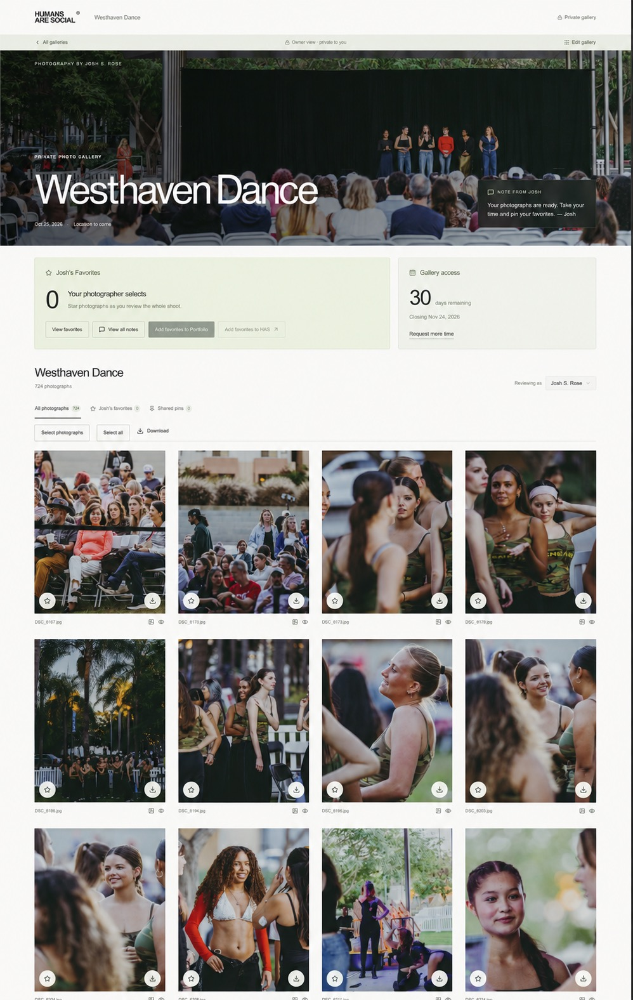
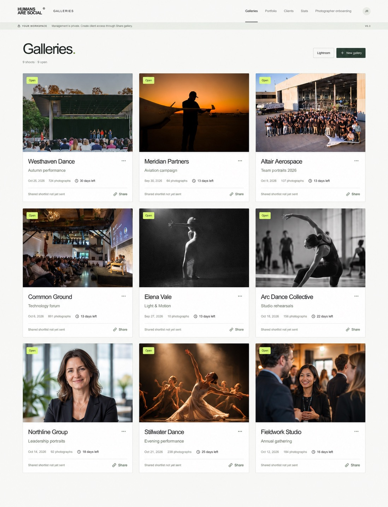
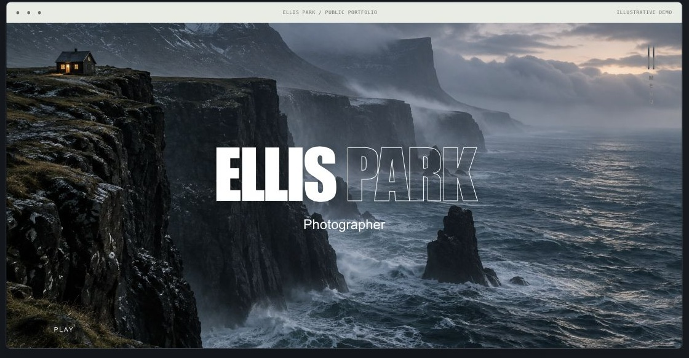
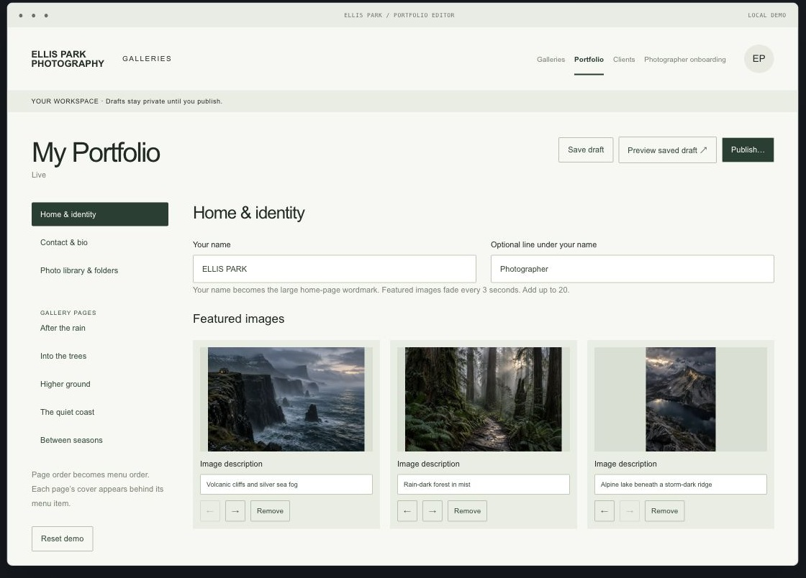

# Galleries

Your photography portfolio. Your client delivery system. Your source code.

Galleries gives photographers a way to move client delivery out of subscription software and into a system they own. Keep the features that work for you, change the ones that don’t, and build what your next assignment needs with a coding assistant. You decide when the software grows, without waiting for a vendor’s next feature release.

**Includes a Lightroom Classic plug-in for creating client galleries and publishing photographs directly from your catalog.** Collections become galleries, edits can be republished, and client selections and notes come back into your editing workflow. Your originals stay in Lightroom.

Built by photographer Josh Rose for his own working studio, now shared as a free, MIT-licensed open-source preview. No Galleries subscription. Your AI tools, hosting, storage and other services may still have their own costs. Setup and validation are required.

## A look inside Galleries

| Gallery owner view | Photographer workspace |
| --- | --- |
|  |  |

**Your public portfolio**

**Your portfolio editor**

Edited demonstration screens with fictional client names. The gallery owner view and dashboard are based on Josh Rose’s screenshots and photographs, edited with AI; four added dashboard cards use generated covers. Portfolio previews use fictional content and simulated publishing controls. These are previews, not bundled client galleries. Photographs in these previews remain copyright Josh Rose and are excluded from the code’s MIT license. See [image notes](docs/images/README.md).

## From Lightroom Classic to your client’s gallery

The included **Lightroom Classic plug-in** connects editing and delivery in one workflow:

- **Create galleries from your catalog.** With a workspace connection, a top-level published collection becomes a gallery. A collection set becomes a gallery, with its child collections organized as sections.
- **Publish directly to Galleries.** Send edited, web-ready JPEG proofs through Lightroom’s Publish Services, while your original files stay in your catalog.
- **Republish without starting over.** Update the same photographs while retaining their source identity and pins.
- **Bring the feedback back.** Retrieve submitted client selections, your own favorites, image notes and crop intentions for the next round of edits.
- **Work with another photographer.** A gallery-scoped connection lets a collaborator publish from their own catalog into a section of the shared gallery.

The plug-in source is included in [lightroom/](lightroom/Studio-Galleries.lrplugin). Configure your own connection and test the full publish, republish and retrieve workflow. A complete fresh-account installation and native Lightroom round trip remain unverified.

## Help clients see what a photograph can become

**Preview a photograph in situation:** a website header, campaign layout, magazine story, profile image, Instagram feed or LinkedIn promoted post. Move the crop and save the intended framing alongside the photograph. Clients can make selections with the final use in mind, then leave a retouching note where you can find it.

These are contextual previews, not automatic publishing to external websites, ad platforms or social accounts.

## Make delivery part of your business

Set a shared pin allowance so the client team can agree on its selects, while keeping your photographer favorites separate. Set a gallery closing date, let clients request more time, and manage extensions from the owner workspace.

Those controls also give you a starting point for your own offers: **additional pins tied to a larger image package, extra retouching, extended gallery hosting, prints or a follow-up session.** You own the source, so you can build the offer around how you actually charge for your work.

Pin allowances, closing dates and extension requests are included. **Paid upgrades, checkout and renewal handling require additional implementation and your own payment integration.** Granting an extension in the current app does not charge the client.

## More of the working photographer’s toolkit

- **A connected public portfolio.** Send photographs or favorites to a portfolio draft, organize gallery pages, edit your identity and contact details, then publish when ready.
- **Shared selections and client collections.** Let clients build a shortlist, submit selects, organize named collections and share scoped collection links.
- **Downloads by purpose.** Offer original, web and email-sized files. Optional background ZIP preparation needs a separately configured worker and queue.
- **Feedback attached to the frame.** Keep notes, crop intentions and submission history with the photographs, plus separate private shoot notes for the studio.
- **Delivery deadlines.** Set gallery lifetimes and let clients add a closing reminder to their calendar.
- **A view of the studio.** Review client activity, upload history, saved weekly reviews and connected storage inventory.

## Own the next feature, too

The starting system is already built. Use it as it is, or open the project in your coding assistant and describe what would make your work easier. A different review flow. A new client offer. A connection to another tool. Review the change, test it and decide when to publish.

Moving away from a delivery subscription also means taking responsibility for your installation. You manage maintenance, security and backups, with an assistant available to help you do the work. The source is yours to keep and adapt.

## Read this before installing

This is an early source release for people comfortable working with a coding assistant and configuring online services. The native route uses ChatGPT/Codex with Sites. Access to those tools must be confirmed on your own account. Claude Code can edit the project, but an independent Cloudflare deployment requires additional authentication and deployment work. Opening this folder in an AI chat does not install a hosted service.

A complete fresh-account deployment and native Lightroom round trip remain unverified. Start with the included fictional sample assignment and complete the [validation checklist](docs/VALIDATION.md) before using client photographs.

## Getting started

Open the whole repository in your coding assistant and ask:

> Read START-HERE.md, AGENTS.md and docs/SETUP.md. Inspect the project and help me choose a supported deployment route. Explain the accounts and costs I need, then guide me one step at a time. Start with the fictional sample gallery. Keep the photographer workspace private and verify client access before using real work.

The setup guide covers branding, pinned dependencies, building both applications, database migrations, storage, email and deployment. Claude users should also read [READ-ME-FIRST-CLAUDE.md](READ-ME-FIRST-CLAUDE.md).

## What you are running

| Folder | Role |
| --- | --- |
| `galleries/` | Private photographer workspace, gallery data and portfolio editor |
| `website/` | Public portfolio and scoped client gateways |
| `lightroom/` | Lightroom Classic plugin |
| `sample-gallery/` | Fictional assignment and AI-generated example images |
| `docs/` | Architecture, setup and acceptance checks |

The owner app relies on Sites authentication. Keep it private. The public website connects through a runtime service credential, and clients receive narrower gallery-scoped access. See [architecture](docs/ARCHITECTURE.md).

## Costs and maintenance

There is no fee or subscription for this source code. Your AI tools, hosting, storage, domain, email and Lightroom may have their own fees or subscriptions. Background ZIP preparation uses an optional separately configured Cloudflare worker and queue. Provider pricing and availability can change; check them before deploying.

You operate your installation, including security, backups, updates and costs. Git backs up code, not uploaded photographs or live databases. AI-assisted changes still need review and testing. The project does not include a guaranteed support response or maintenance schedule.

## Contributing

Start with [CONTRIBUTING.md](CONTRIBUTING.md). Reproducible setup reports are especially useful at this stage. Never include real client photos, private gallery links or credentials in issues.

## License

Original project source is available under [MIT](LICENSE). You may use, modify and redistribute it, including commercially, while preserving the license notice. Bundled third-party components retain their own notices; see [THIRD-PARTY-NOTICES.md](THIRD-PARTY-NOTICES.md).
